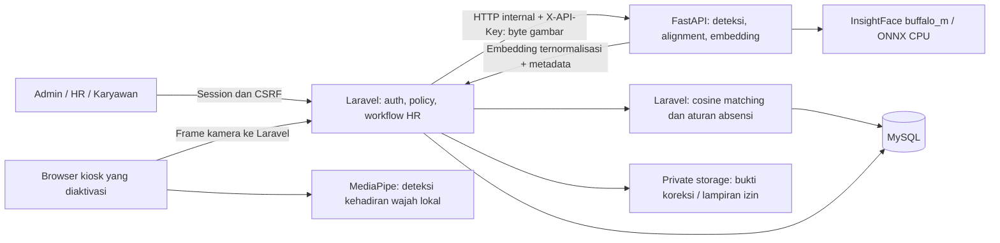

<p align="center">
  
</p>

# FaceTrack AI

*AI-Powered Employee Attendance Management System*

FaceTrack AI menghubungkan pengenalan wajah dengan pencatatan kehadiran dan proses administrasi HR. Laravel menangani akun, kebijakan akses, dan aturan absensi; layanan Python menjalankan inferensi model wajah. Proyek portofolio personal ini merupakan **prototipe**: fitur aplikasi telah diimplementasikan, tetapi akurasi pengenalan dan kesiapan produksi belum dievaluasi secara menyeluruh.


[Instalasi](docs/local-development.md) · [Pipeline AI](docs/recognition-pipeline.md) · [Pengujian dan audit](docs/documentation-audit.md) · [Screenshot](docs/screenshots/README.md)

## Gambaran proyek

Pencatatan absensi manual dapat menambah pekerjaan administratif, memecah data kehadiran, memperlambat pelaporan, dan menyulitkan penanganan koreksi. FaceTrack AI dirancang untuk menyatukan identifikasi berbasis Computer Vision, pencatatan otomatis, ringkasan kehadiran, dan keputusan HR dalam satu alur dengan pembatasan akses per peran.

Ide proyek berangkat dari pengalaman studi kasus absensi perusahaan pada Capstone sebelumnya. Repositori ini adalah pengembangan personal; **bukan klaim bahwa versi FaceTrack AI ini digunakan atau telah di-deploy oleh perusahaan tersebut**. Dampak terhadap beban kerja HR belum diukur.

## Fitur dan status

**Implemented** berarti tersedia dalam kode dan cakupan pengujian terkait; bukan jaminan kualitas pengenalan di perangkat atau kondisi lapangan. **In Development** berarti fondasinya tersedia tetapi validasi belum selesai. **Planned** berarti belum menjadi kemampuan aktif aplikasi.

| Komponen | Kemampuan | Status |
| --- | --- | --- |
| Administrator | Pengelolaan akun, role HR/Employee, status akun, undangan dan aktivasi password | Implemented |
| Administrator | Dashboard dan monitoring absensi; direktori/detail profil penuh dibatasi untuk HR | Implemented |
| HR | Tambah/edit profil, NIK, ID bisnis, divisi, pencarian dan pagination | Implemented |
| HR | Enrollment dengan consent, re-enrollment, penghapusan embedding dan audit enrollment | Implemented |
| HR | Dashboard ringkasan/tren/divisi, filter absensi, ekspor CSV | Implemented |
| HR | Approve/reject koreksi dan izin, bukti privat, pencatatan keputusan di database | Implemented |
| Karyawan | Riwayat absensi sendiri, pengajuan koreksi berkamera/lokasi dan izin/sakit/cuti | Implemented |
| AI | Deteksi, alignment, embedding 512 dimensi, cosine matching, threshold dan margin kandidat | Implemented |
| Kiosk | Aktivasi perangkat oleh HR, kamera, pemicu scan otomatis, jeda/lanjut, pesan hasil | Implemented |
| Absensi otomatis | Check-in/out menurut waktu server, cegah duplikasi dan konflik izin | Implemented |
| Evaluasi AI | Skrip evaluasi tersedia; kalibrasi threshold dan benchmark peserta belum dipublikasikan | In Development |

Keputusan approval bersifat final pada alur saat ini. Log keputusan tetap disimpan, walaupun section riwayat keputusan telah dihapus dari halaman detail. Koreksi menggunakan waktu server **saat diajukan**, bukan input tanggal/jam manual atau waktu HR menyetujui.

## Arsitektur sistem



Laravel mengelola autentikasi, otorisasi, profil, transaksi database, dashboard, dan approval. FastAPI memproses gambar serta menghasilkan embedding; **identifikasi karyawan dilakukan di Laravel**, bukan di browser atau FastAPI. MySQL menyimpan akun, profil, kehadiran, permohonan, log keputusan, perangkat kiosk, serta embedding terenkripsi.

MediaPipe di browser hanya membantu menentukan kapan wajah stabil untuk dikirim. Komponen ini tidak mengenali identitas dan tidak melakukan liveness. Aset model dan WASM browser dilayani dari origin aplikasi.

## Implementasi AI

Aplikasi memakai model **pre-trained InsightFace `buffalo_m`**, tanpa training dari nol atau fine-tuning. Hanya model deteksi `det_2.5g.onnx` dan pengenal `w600k_r50.onnx` yang dimuat melalui `CPUExecutionProvider`.

1. Kamera mengirim frame sementara; backend memeriksa format dan ukuran.
2. Python mensyaratkan tepat satu wajah, lalu memeriksa ukuran, landmark, blur, dan pencahayaan.
3. Alignment lima landmark menghasilkan embedding 512 dimensi yang dinormalisasi L2.
4. Laravel membandingkan probe dengan embedding enrollment yang memiliki identitas model sama. Skor karyawan adalah skor tertinggi dari sampelnya.
5. Kandidat diterima jika melewati `FACE_SIMILARITY_THRESHOLD` dan selisih terhadap kandidat kedua memenuhi `FACE_IDENTIFICATION_MARGIN`. Kegagalan kondisi ini ditolak sebagai wajah yang belum dikenali dengan cukup yakin.
6. Aturan absensi memeriksa jadwal, status karyawan, izin, sesi, dan duplikasi sebelum transaksi disimpan.

Pendekatan embedding memungkinkan penambahan karyawan melalui enrollment tanpa melatih ulang model. Enrollment menerima 3–5 sampel, memeriksa konsistensi antarsampel, dan mengurangi sampel yang hampir identik. Frame enrollment/recognition tidak disimpan; foto bukti **koreksi** adalah alur berbeda dan disimpan privat.

Threshold pada [`.env.example`](.env.example) sengaja kosong: absensi ditolak sampai nilainya valid. Tidak ada nilai optimal yang diklaim; threshold dan margin perlu dikalibrasi memakai peserta terdaftar serta tidak terdaftar. [Pipeline dan evaluasi](docs/recognition-pipeline.md) menjelaskan kontrak API dan metodologinya.

## Technology stack

| Layer | Teknologi yang digunakan |
| --- | --- |
| Web backend | PHP `^8.3`, Laravel `^13.0`, Eloquent |
| Frontend | Blade, Tailwind CSS 4, JavaScript ES modules, Vite 6 |
| Pemicu kamera kiosk | `@mediapipe/tasks-vision` 1.2.3, BlazeFace lokal |
| AI service | Python 3.10, FastAPI, Uvicorn, Pydantic Settings |
| Face recognition | InsightFace 2.1, model pack `buffalo_m` |
| Computer Vision | OpenCV, NumPy, Pillow, ONNX Runtime CPU |
| Database | MySQL|
| Integrasi | HTTP REST internal dengan `X-API-Key` |
| Pengujian | PHPUnit, Node test runner, pytest |

Versi dependensi yang dipatok tersedia di [composer.lock](composer.lock), [package-lock.json](package-lock.json), dan [requirements-lock.txt](ai-service/requirements-lock.txt).

## Instalasi dan konfigurasi lokal

Panduan lengkap Windows PowerShell tersedia di **[Installation & Local Development](docs/local-development.md)**, termasuk prasyarat PHP/Python, MySQL, akun awal, konfigurasi email, model, API key, health check, dan troubleshooting.

```powershell
git clone https://github.com/tsaalytics/face-recognition-project.git
Set-Location face-recognition-project
composer install
npm.cmd ci
Copy-Item .env.example .env
php artisan key:generate
```

Atur database khusus pengembangan di `.env`, kemudian jalankan `php artisan migrate`. Jangan menjalankan `migrate:fresh` pada database existing. Demo seeder hanya untuk database demo lokal; panduan menjelaskan data dan akun yang dibuatnya.

Jalankan Laravel di `http://127.0.0.1:8000` dan FastAPI di `http://127.0.0.1:8001` melalui terminal terpisah. Port dapat diganti jika terpakai, dengan memperbarui `APP_URL` atau `AI_SERVICE_URL`. FastAPI tidak otomatis ikut hidup saat `php artisan serve` atau `composer run dev` dijalankan.

| Variabel | Tujuan |
| --- | --- |
| `APP_URL`, `APP_KEY` | URL aktivasi akun dan kunci enkripsi Laravel; buat key dengan Artisan |
| `DB_CONNECTION`, `DB_HOST`, `DB_PORT`, `DB_DATABASE`, `DB_USERNAME`, `DB_PASSWORD` | Database aplikasi |
| `MAIL_MAILER`, `MAIL_HOST`, `MAIL_PORT`, `MAIL_USERNAME`, `MAIL_PASSWORD`, `MAIL_FROM_ADDRESS` | Pengiriman undangan; `log` untuk development |
| `AI_SERVICE_URL`, `AI_SERVICE_API_KEY`, `AI_REQUEST_TIMEOUT` | Endpoint Python, shared secret server, dan timeout |
| `FACE_MODEL_NAME` | Model yang didukung: `buffalo_m` |
| `FACE_SIMILARITY_THRESHOLD`, `FACE_IDENTIFICATION_MARGIN` | Batas penerimaan dan pemisahan kandidat |
| `FACE_ENROLLMENT_CONSISTENCY_THRESHOLD`, `FACE_ENROLLMENT_DUPLICATE_THRESHOLD` | Heuristik konsistensi/deduplikasi enrollment |

Konfigurasi Python berada di [`ai-service/.env.example`](ai-service/.env.example). Jangan menaruh secret di `VITE_*`, README, screenshot, atau repository.

## Alur aplikasi

**Aktivasi akun:** HR melengkapi profil aktif → Admin membuat akun HR/Employee dan mengirim undangan → penerima menetapkan password sendiri → akun aktif. Tidak ada registrasi publik. Token undangan berlaku 60 menit dan sekali pakai.

**Enrollment:** HR memilih karyawan dan mencatat persetujuan → kamera mengambil 3–5 sampel → FastAPI menghasilkan embedding → Laravel memeriksa konsistensi dan menyimpan embedding terenkripsi → status enrollment dan audit diperbarui.

**Absensi:** HR menerbitkan kode perangkat → browser diaktivasi melalui `/kiosk/activate` → kamera mendeteksi wajah stabil → Laravel meminta embedding dan melakukan matching → aturan server menentukan check-in/out → catatan disimpan atau alasan kegagalan ditampilkan.

Jadwal saat ini satu sesi `regular` dalam `Asia/Jakarta`: sebelum 05.00 check-out hari sebelumnya, 05.00–sebelum 06.00 tutup, 06.00–sebelum 17.00 check-in, mulai 17.00 check-out hari ini. Batas tepat waktu adalah 08.00 dengan grace period 0 menit. Nilainya diatur di [config/attendance.php](config/attendance.php), bukan jam perangkat pengguna. Check-out memerlukan check-in sebelumnya.

## Keamanan dan privasi

- Session authentication, pembatasan akun aktif, role middleware, policies kepemilikan, CSRF, dan rate limiting pada endpoint terkait.
- Identitas, waktu, jadwal dan hasil keputusan ditentukan server; transaksi, row locks, serta unique constraints melindungi konsistensi absensi/approval.
- Embedding menggunakan Eloquent `encrypted:array` dan disembunyikan dari serialisasi model. Kunci Laravel tetap diperlukan untuk dekripsi; pengelolaan kunci dan backup menjadi tanggung jawab operator.
- Foto koreksi dan lampiran izin berada di `storage/app/private`, melalui controller dengan pemeriksaan izin; bukan URL penyimpanan publik.
- FastAPI mensyaratkan `X-API-Key`, membatasi ukuran/rate request, dan tidak menyediakan CORS. Deployment lokal mengikat layanan ke loopback. Pipeline memproses frame/vektor inferensi di memori tanpa persistensi yang disengaja.
- Kode pairing dan token perangkat disimpan sebagai hash; aktivasi mengakhiri login dashboard pada browser tersebut. Akses perangkat dapat dicabut HR.
- Database menyimpan audit enrollment dan keputusan approval serta sumber catatan absensi; ini bukan audit log menyeluruh untuk setiap request.

Embedding tetap merupakan **data biometrik sensitif** meskipun terenkripsi. Gunakan persetujuan peserta, jangan unggah foto/embedding ke repository, dan tentukan retensi sebelum uji dengan data nyata. Kiosk standalone belum memiliki consent individual per scan. Pengenalan wajah belum membuktikan liveness; prototipe ini tidak layak langsung dijadikan dasar keputusan kehadiran atau payroll tanpa evaluasi lebih lanjut.

## Keterbatasan dan pengembangan berikutnya

| Kondisi saat ini | Pengembangan berikutnya — Planned |
| --- | --- |
| Threshold, margin, serta heuristik kualitas belum dikalibrasi terhadap cohort peserta | Kalibrasi dan benchmark dengan holdout, known/unknown, serta kondisi cahaya berbeda |
| Belum ada liveness/anti-spoofing | Evaluasi serangan foto/video dan integrasi liveness |
| Matching melakukan pencarian linear terhadap embedding yang relevan | Benchmark skala gallery dan optimasi bila terukur diperlukan |
| Satu sesi regular; belum ada roster multi-shift atau kalender libur | Jadwal per karyawan, kebijakan hari kerja dan saldo cuti |
| Kamera, browser, dan jaringan fisik belum tervalidasi secara menyeluruh | Pengujian perangkat kiosk dan pemulihan gangguan berulang |
| Belum ada bukti deployment produksi, audit keamanan, atau kebijakan retensi otomatis | Hardening, supervisi proses, TLS, backup dan uji pemulihan |