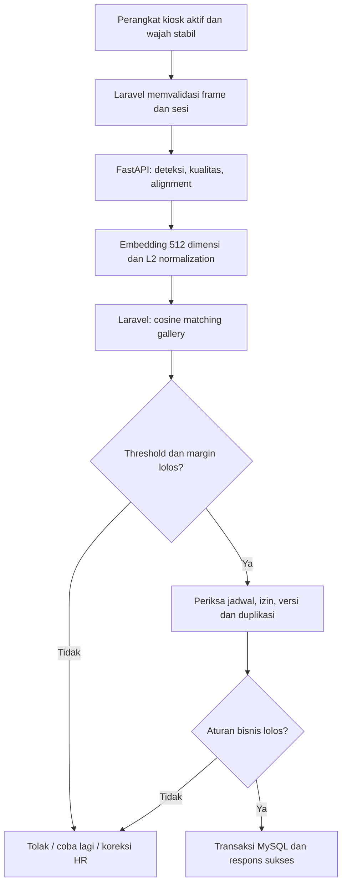

# Pipeline face recognition dan evaluasi

[Kembali ke README](../README.md) · [Instalasi](local-development.md)

Dokumen ini menjelaskan implementasi yang diaudit 18 November 2026. Model pre-trained tidak dilatih ulang saat enrollment. Pendaftaran menambahkan template embedding; recognition membandingkan template dengan probe baru.

## Batas tanggung jawab

| Komponen | Implementasi |
| --- | --- |
| Browser | Kamera, pemicu wajah stabil melalui MediaPipe, frame sementara, UI hasil. Tidak menentukan employee ID atau waktu absensi |
| Laravel | Validasi request/role/perangkat, panggil AI, dekripsi gallery, cosine matching, aturan absensi dan transaksi |
| FastAPI | Decode gambar, deteksi dan kualitas wajah, alignment, embedding dan metadata |
| MySQL / private storage | Embedding terenkripsi dan metadata; bukti koreksi/izin terpisah dari inferensi |

Legacy binding `FaceRecognitionService → DisabledFaceRecognitionService` masih ada di provider. Jalur aktif enrollment/kiosk memanggil `FaceExtractionClient` dan `FaceAttendanceService` secara langsung; binding lama bukan bukti bahwa kiosk saat ini dinonaktifkan.

## Model dan preprocessing

[ModelRuntime](../ai-service/model_runtime.py) memuat dua file `buffalo_m`: `det_2.5g.onnx` (deteksi) dan `w600k_r50.onnx` (recognition). Installer dan startup memeriksa digest/provenance; file landmark/atribut tambahan pada model pack tidak dimuat. ONNX memakai CPU, bukan training atau GPU pipeline.

[FaceEngine](../ai-service/face_engine.py) menjalankan:

1. Validasi MIME JPEG/PNG/WebP, header, ukuran, dimensi, serta gambar nonanimasi.
2. Decode OpenCV, dengan orientasi EXIF diabaikan.
3. Deteksi seluruh wajah; tepat satu wajah wajib tersedia.
4. Pemeriksaan bounding box penuh, ukuran, skor deteksi, lima landmark valid, blur, dan brightness.
5. Alignment lima landmark di `recognition.get` milik InsightFace.
6. Ekstraksi embedding finite berdimensi 512 dan normalisasi L2.

Heuristik default Python: sisi wajah minimum 80 px, deteksi minimal 0,6, variance blur minimal 50 pada crop 112×112, dan brightness 40–215. Ini bukan hasil kalibrasi atau liveness.

## Kontrak HTTP internal

`X-API-Key` wajib untuk kedua endpoint. Service diikat ke loopback dalam setup lokal; browser tidak pernah menerima key.

| Endpoint | Request | Respons |
| --- | --- | --- |
| `GET /health` | Tanpa gambar | 200 ketika runtime ready; 503 jika model tidak tersedia; status, kode, metadata model |
| `POST /face/extract-embedding` | Byte gambar mentah, `Content-Type: image/jpeg`, PNG atau WebP | Embedding dan metadata; bukan identitas karyawan |

Bukan JSON base64 atau multipart pada koneksi Laravel–Python. Browser mengirim sampel data URL ke Laravel; Laravel mendecode dan meneruskan byte ke Python. Respons sukses mempunyai `status`, `model_name`, `model_identifier`, `embedding_dimension`, `embedding`, dan metadata `quality`.

Laravel memeriksa dimensi, tipe angka, normalisasi, identifier model, dan metadata sebelum menggunakannya. Pesan kegagalan membedakan kualitas frame dari layanan yang tidak tersedia; respons AI sembarang tidak dipercaya.

Batas default Python: 5 MiB/gambar, sisi 32–4096 px, maksimum 12 juta pixel, body timeout 10 detik, ekstraksi 30 request/menit. Laravel membatasi sampel enrollment/scan hingga 1 MiB per gambar, 3–5 sampel enrollment dan satu sampel scan; timeout client default 15 detik, serta deadline keseluruhan enrollment 25 detik. Nilai konfigurasi ada di [face.php](../config/face.php) dan [config.py](../ai-service/config.py).

## Enrollment

HR harus berhak mengelola wajah, profil aktif, ID bisnis tersedia, consent diterima, dan versi enrollment cocok. Semua sampel divalidasi sebelum request AI pertama.

- Minimal 3, maksimal 5 sampel kamera.
- Sampel harus mempunyai identifier model sama dan cosine similarity antarsampel minimal `FACE_ENROLLMENT_CONSISTENCY_THRESHOLD` (default 0,65).
- Sampel yang cosine similarity-nya minimal `FACE_ENROLLMENT_DUPLICATE_THRESHOLD` (default 0,9999) terhadap sampel lain tidak disimpan dua kali.
- Deduplikasi ini **antarsampel enrollment**, bukan jaminan deteksi satu orang yang didaftarkan sebagai dua karyawan.
- Transaksi mengunci actor/profil, mengganti template lama, menambah versi enrollment, lalu menulis audit. Delete enrollment menghapus embedding dan memperbarui status/audit.
- Eloquent `encrypted:array` melindungi embedding saat disimpan; quality metadata tidak ikut terenkripsi oleh cast tersebut. Foto enrollment tidak disimpan.

Sumber: [FaceEnrollmentService](../app/Services/FaceEnrollmentService.php), [EmployeeFaceEmbedding](../app/Models/EmployeeFaceEmbedding.php).

## Matching dan pencatatan

Cosine similarity:

```text
cosine(p, e) = dot(p, e) / (norm(p) * norm(e))
score(employee) = max(cosine(probe, each enrolled sample))
accept when:
  best_score >= threshold
  and, if a second candidate exists, best_score - second_score >= margin
```

[FaceAttendanceService](../app/Services/FaceAttendanceService.php) menyaring gallery untuk model/identifier yang sama, dimensi 512, enrollment aktif dan karyawan aktif dengan ID bisnis. Gallery dimuat dari database dan dibandingkan secara linear; tidak ada vector database atau approximate nearest-neighbor index.

Threshold harus finite pada rentang `0 < t <= 1`. Margin harus finite pada rentang `0 < m <= 1`; default 0,05. Gallery kosong, skor rendah, atau kandidat ambigu ditolak. Istilah unknown di UI berarti tidak cukup yakin menerima kandidat, bukan bukti orang itu pasti belum pernah didaftarkan.

Sesudah matching, transaksi memeriksa ulang versi enrollment, status actor/perangkat, profil, jadwal, izin, dan absensi sebelumnya. Satu record per karyawan/tanggal/sesi dilindungi unique constraint. Check-out memerlukan check-in. Record hasil koreksi/izin tidak ditimpa jalur wajah. Sumber sukses adalah `face_recognition`.



## Evaluasi yang tersedia dan yang belum

**Hasil peserta: Not evaluated yet.** Tidak ada klaim accuracy, FAR, FRR, atau kecepatan produksi. Model warm-up dan smoke test sintetis memverifikasi runtime, bukan kemampuan mengenali orang.

[Evaluator](../ai-service/scripts/evaluate_faces.py) menjalankan engine model asli secara lokal dan Python matching yang meniru aturan skor Laravel. Ini tidak melewati kamera, HTTP Laravel, atau transaksi database.

- Pisahkan peserta kalibrasi dan peserta holdout; validator menolak overlap subject antar-split.
- Gallery dan known probe harus berbeda sesi. Sertakan peserta unknown pada kedua split.
- Validator menolak duplikasi hash gambar, path yang keluar root, consent tidak terkonfirmasi, serta metadata yang tidak lengkap.
- Pilih threshold menggunakan split kalibrasi; bekukan threshold/margin sebelum holdout. Mengubahnya setelah melihat hasil test memerlukan holdout baru.
- Laporkan ukuran gallery/cohort, kondisi cahaya, kegagalan ekstraksi, model identifier, versi dependency, CPU/RAM, dan ketidakpastian. Repeated probes tidak identik dengan peserta independen.

Manifest lokal privat memakai `schema_version: 1`, `consent_confirmed: true`, dan `records` berisi `split` (calibration/test), `role` (gallery/probe), `subject` pseudonim, `session`, `path` relatif manifest, `lighting` (bright/normal/dim/backlit). Setiap split memerlukan sedikitnya dua subject gallery dengan masing-masing 3–5 sampel, known probes dari sesi berbeda, serta unknown probes. Path gambar harus berada di dalam root manifest dan maksimal 1 MiB; satu contoh record saja tidak cukup untuk lolos evaluasi.

Contoh command dari root, **setelah** dataset/manifest dan consent benar-benar disiapkan:

```powershell
New-Item -ItemType Directory -Force ai-service/evaluation-results
.\ai-service\.venv\Scripts\python.exe ai-service/scripts/evaluate_faces.py ai-service/evaluation-data/manifest.json --consent-confirmed --split calibration --thresholds 0.40 0.50 0.60 --margin 0.05 --cpu "YOUR_CPU_MODEL" --ram-gib 16 --output ai-service/evaluation-results/calibration.json
```

Angka threshold dan RAM di command adalah contoh input, bukan hasil atau rekomendasi. Setelah threshold dipilih, gunakan `--split test --threshold YOUR_FROZEN_VALUE` menggantikan argumen split/thresholds. Output tidak boleh sudah ada. File privat evaluation-data/results dikecualikan Git. Skrip memakai consistency/dedup enrollment 0,65/0,9999; samakan konfigurasi Laravel agar perbandingan relevan.

| Metrik | Definisi / batas pengukuran |
| --- | --- |
| Open-set accuracy | Known beridentitas benar dan unknown ditolak, dibagi semua probe |
| FAR | Unknown diterima sebagai anggota gallery / seluruh probe unknown |
| FRR | Known ditolak / seluruh probe known |
| Known misidentification | Known diterima dengan identitas salah, dilaporkan terpisah dari FRR |
| Extraction latency | Wall time decode/detect/quality/embedding; termasuk kategori gagal, dengan subset sukses terpisah |
| Mean/P95 | Rata-rata dan nearest-rank P95; warm-up startup dilaporkan terpisah |
| End-to-end Laravel | Belum dihitung evaluator; field laporan bernilai null |

Untuk waktu absensi end-to-end, lakukan pengukuran terpisah dari pengambilan frame hingga respons database, termasuk network/HTTP, matching dan transaksi. `Server-Timing: app;dur=...` pada respons sukses scan adalah durasi controller, bukan waktu kamera atau network penuh.

## Batas keamanan

Tidak ada liveness, retraining online, audit fairness peserta, atau bukti kebal serangan foto/video. Kiosk standalone tidak menanyakan consent individual setiap scan. Kebijakan consent lapangan, retensi, hak akses operator dan pemulihan kunci memerlukan keputusan sebelum penggunaan nyata. Informasi embedding/identitas peserta dan frame tidak boleh dimasukkan ke log pengujian publik.
